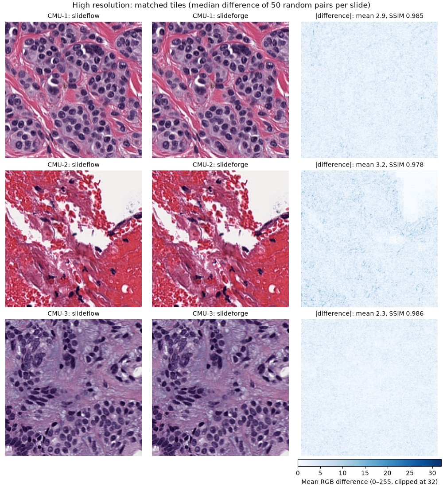
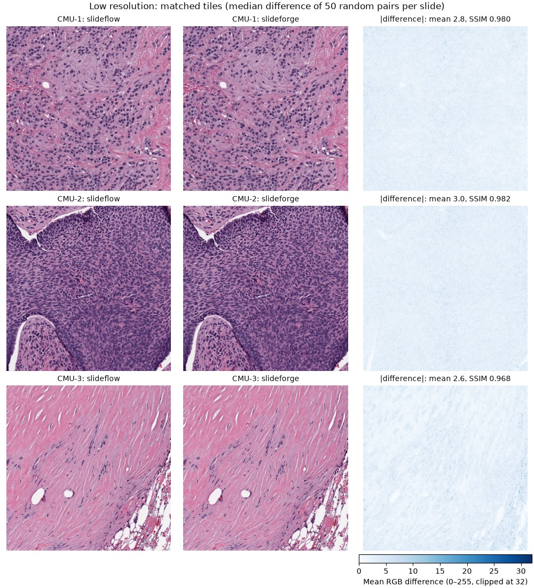
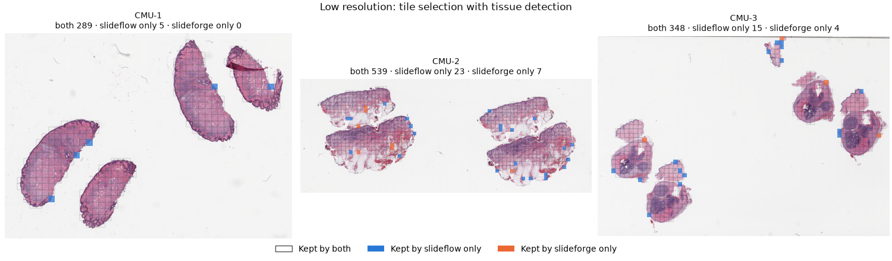

# Tile extraction: slideflow vs. slideforge, results

Status: experimental (`exp/slideforge-tiling`). Measured: 2026-11-07/08.

This document summarizes the results of a full benchmark run comparing the two tiling backends (default slideflow and experimental slideforge) with regards to speed, memory usage and tile quality. Preliminary evaluation indicate that slideforge is the faster option while featuring similar tile quality, although these are not definitive results (see [Limitations](#limitations)).

## Summary

- **Speed:** slideforge was faster in 11 of 12 settings, by 1.2–3.5×. Comparing each backend's fastest setting, it
  took 3.6 s instead of 11.1 s (High resolution, tissue detection on).
- **CPU:** slideforge used 1.6–3.7× less CPU time in all 12 settings.
- **Scaling:** slideflow seems to barely speed up beyond 4 threads. slideforge kept getting faster up to 16 threads.
- **Same tiles:** without tissue detection, both produce the same grid (Jaccard 1.0) with nearly identical pixels
  (mean SSIM ≥ 0.99). With tissue detection, 94–96% of tiles agree at the calibrated `min_tissue_fraction=0.4`
  (mean SSIM 0.98). slideforge also keeps gray scan artifacts that slideflow drops (see [Tile selection](#tile-selection)).
- **Exception:** at Low resolution with tissue detection on and one thread, slideflow was faster (19.6 s vs. 24.4 s),
  because it used about 2 cores even with `num_threads=1`.
- **Not tested yet:** Differences in stain normalization (on by default in AutoMIL), whether models trained on slideforge tiles perform
  differently, and slide formats other than SVS.

## Methods

The new `Tiling` module exposes two classes representing the tiling backends which both feature a `.extract` serving as the entry point for tile extraction. The desired backend can be selected with `Dataset(tiler=TileBackendType.…)` or the (currently hidden) `--tiler` CLI option, and both write
slideflow-compatible tfrecords and index files. Downstream tasks such as training and evaluation are performed indentically.

| | slideflow (default) | slideforge (experimental) |
|---|---|---|
| Implementation | Python, `sf.Dataset.extract_tiles`, worker processes | Rust library with a Python binding, rayon threads |
| Slide reading | cucim (or libvips) | Own SVS/TIFF reader |
| Slide formats | Everything cucim / libvips reads | SVS only |
| Parallelism setting | `num_threads` (worker processes) | `threads` (per slide) |
| JPEG quality | 95 | 95 (`jpeg_quality`, set by `SlideforgeBackend`), 4:2:0 chroma subsampling |
| Edge tiles | Dropped | Dropped |
| Stain normalization | Reinhard, slideflow's target | Reinhard, slideforge's own target |
| Index files | Written by slideflow | Written by `write_index` in `automil/tiling.py` afterwards |
| Install | Base dependency | `pip install automil[slideforge]`, built from source (needs Rust) |

### Tissue detection

Both detect tissue in two stages: once on a low-resolution overview of the whole slide, and once per tile.

| | slideflow (`qc="otsu"`) | slideforge (`min_tissue_fraction`) |
|---|---|---|
| Overview | Smallest pyramid level with shorter side > 500 px | Lowest pyramid level |
| Signal | HSV saturation, 7×7 median blur | Grayscale, no blur |
| Threshold | One Otsu threshold per slide, tissue is above it | One Otsu threshold per slide, tissue is at or below it |
| Stage 1 (overview, before reading at full resolution) | Drop a tile if more than 60% of it is background | Drop a tile if less than `min_tissue_fraction` of it is tissue |
| Stage 2 (each decoded tile) | Grayspace filter: drop if more than 60% of pixels have saturation < 0.05 | Tissue fraction recomputed at full resolution with the same threshold |

Both rules keep a tile with at least 40% tissue, which matches the calibrated `min_tissue_fraction` of 0.4. The two will
never select exactly the same tiles, because they threshold different signals.

## Setup

| | |
|---|---|
| Slides | OpenSlide test data: CMU-1, CMU-2, CMU-3 (SVS, 170–390 MB, checksums below) |
| Resolutions | High: 299 px / 149 µm (20×). Low: 1000 px / 500 µm (10×) |
| Settings | 2 backends × 2 resolutions × tissue detection on/off × 1, 4, 16 threads, 3 repeats each (72 runs) |
| Stain normalization | Off |
| Machine | AMD Ryzen 7 5800X (8 cores / 16 threads), WSL2 with 8 GB RAM, slides on the WSL disk |
| Software | Python 3.12.3, slideflow 3.0.2 (cucim 26.10), slideforge 37773ea, AutoMIL f3edb49 + this branch |

Each run uses a fresh subprocess and slideflow project. Pending disk writes are flushed before each run. The page cache
is not dropped, so slides are read from a warm cache. Times are wall-clock time of the extraction call (including index
writing for slideforge). Memory is the peak PSS of the process tree, which includes about 1 GB from importing slideflow.

## Results

The following tables show the median of 3 runs. Speedup and CPU ratio are slideflow divided by slideforge, so values above 1 indicate better performance via slideforge.

### High resolution (299 px, 20×)

| Tissue | Threads | slideflow (s) | slideforge (s) | Speedup | CPU time ratio | Peak memory (MB), sf / sfg | Tiles, sf / sfg |
|---|---|---|---|---|---|---|---|
| on | 1 | 46.6 | 25.2 | 1.8× | 1.9× | 1221 / 1055 | 13,232 / 13,582 |
| on | 4 | 15.0 | 7.3 | 2.1× | 2.1× | 1329 / 1116 | 13,232 / 13,582 |
| on | 16 | 11.1 | 3.6 | 3.1× | 1.9× | 1894 / 1089 | 13,232 / 13,582 |
| off | 1 | 150.6 | 72.0 | 2.1× | 2.2× | 1234 / 1315 | 77,154 / 77,154 |
| off | 4 | 41.9 | 21.3 | 2.0× | 2.2× | 1278 / 1598 | 77,154 / 77,154 |
| off | 16 | 42.0 | 11.9 † | 3.5× | 2.4× | 2025 / 1556 | 77,154 / 77,154 |

### Low resolution (1000 px, 10×)

| Tissue | Threads | slideflow (s) | slideforge (s) | Speedup | CPU time ratio | Peak memory (MB), sf / sfg | Tiles, sf / sfg |
|---|---|---|---|---|---|---|---|
| on | 1 | 19.6 | 24.4 | **0.8×** | 1.6× | 1096 / 1127 | 1,219 / 1,187 |
| on | 4 | 10.7 | 8.0 | 1.3× | 2.3× | 1583 / 1185 | 1,219 / 1,187 |
| on | 16 | 9.7 | 4.8 | 2.0× | 2.1× | 2514 / 1354 | 1,219 / 1,187 |
| off | 1 | 87.5 | 72.9 | 1.2× | 3.3× | 1084 / 1263 | 6,675 / 6,675 |
| off | 4 | 36.6 | 22.7 | 1.6× | 3.7× | 1377 / 1334 | 6,675 / 6,675 |
| off | 16 | 35.5 | 14.6 | 2.4× | 2.4× | 2277 / 1476 | 6,675 / 6,675 |

† Two of the three runs were hit by disk write stalls (see below). The only clean run took 10.1 s.

Notes:

- **Single-thread runs:** at Low resolution, slideflow used 2.0–2.8 cores even with `num_threads=1`, so those times
  aren't single-core times. The CPU time ratio is the fairer comparison there, and it favours slideforge in every setting.
- **Memory:** slideforge's peak was lower in every 16-thread setting (1.1–1.6 GB vs. 1.9–2.5 GB). It was higher in four
  of the single- and four-thread settings, by up to 0.3 GB.
- **Disk usage:** slideforge's tfrecords were 2–6% larger (e.g. 740 vs. 701 MB at High with tissue detection).
- **Disk stalls:** 4 of 72 runs spent more than 5% of their time waiting on writes (WSL virtual-disk write stalls,
  measured with Linux pressure stall information). The medians above include them. The affected settings are
  slideforge at High / off / 16 and, once each, slideflow at High / on / 16 and Low / on / 4.

### Tile equivalence

Compared with `compare.py`, which matches tiles by location and computes pixel similarity on 50 tiles per slide.

| | Tile overlap (Jaccard) | Mean SSIM of matched tiles |
|---|---|---|
| Tissue detection off | 1.00 on all three slides | 0.991–0.996 |
| Tissue detection on, `min_tissue_fraction=0.4`, High | 0.948 overall (0.92–0.99 per slide) | 0.981 (0.980–0.982) |
| Tissue detection on, `min_tissue_fraction=0.4`, Low | 0.959 overall (0.95–0.98 per slide) | 0.981 (0.980–0.982) |

The pixel differences come from the two implementations' different resizing and JPEG encoding. The mean absolute
difference is 0.4–0.9 of 255 without tissue detection and 2.3–3.2 with it, most likely because the tiles kept without
tissue detection are mostly uniform background, where both encoders agree.





For each slide, the figures show the matched tile pair with the median difference among 50 random pairs, so they are
typical, not best-case, examples. The differences have no visible structure apart from slightly larger values along
edges and in fine texture.

### Tile selection

The maps show which tiles only one backend kept (tissue detection on, `min_tissue_fraction=0.4`):




Most disagreements are single tiles along the tissue border, where the two signals put the edge in slightly different
places. One pattern is systematic: on CMU-3 at High resolution, 117 of the 254 tiles that only slideforge kept lie
along the slide's top edge, where the scan has a gray band with no tissue. Grayscale detection counts dark gray as
tissue, while slideflow's saturation signal ignores it. Switching slideforge to a saturation-based signal would remove
this kind of artifact.

### Calibrating `min_tissue_fraction`

`calibrate.py` compares slideforge's tile selection at different `min_tissue_fraction` values with slideflow's (Jaccard
over all three slides):

| `min_tissue_fraction` | 0.3 | 0.35 | **0.4** | 0.45 | 0.5 |
|---|---|---|---|---|---|
| High | 0.913 | 0.933 | **0.942** | 0.931 | 0.900 |
| Low | 0.923 | 0.956 | **0.956** | 0.911 | 0.858 |

0.4 was the best value at both resolutions (at Low narrowly: 0.9561 vs. 0.9557 for 0.35) and also won every leave-one-slide-out split, within 0.01. It's only
calibrated on these three slides. Rerun `calibrate.py` on a sample of a new dataset before relying on it.

## Limitations

- **Limited dataset size**: The benchmark has been computed on 3 slides only from the [OpenSlide test data](https://openslide.cs.cmu.edu/download/openslide-testdata/Aperio/). Subsequent benchmark runs should be computed on full WSI datasets.

- **Differences stain normalization.** While both backends utilized reinhard normalization, the two implementations use different target colours, and are therefore not fully equivalent. Slideforges implementation could be revised to match slideflows implementation more closely.
- **No downstream evaluation.** The full AutoMIL pipeline has not been run usng the experimental backend, providing no insight on whether models trained on the different tile sets perform better or worse.
- **WSL2 environment.** The experiment was run on a Windows Subsystem for Linux (WSL) with an Ubuntu 24.04 distro and is not representative of a native Linux environment.
- **SVS only.** slideforge can't read the other formats slideflow supports.

## Reproducing

```sh
pip install -e ".[slideforge]"
python benchmarks/tiling/bench.py --slides <slides> --out <out> \
    --resolution High --resolution Low --threads 1 --threads 4 --threads 16 --repeats 3
python benchmarks/tiling/calibrate.py --slides <slides> --out <out>/calibration --resolution High --resolution Low

# Figures: keep the tfrecords of one run per backend, then draw from them (High shown, Low uses --tile-um 500)
python benchmarks/tiling/bench.py --slides <slides> --out <out>/figures --resolution High --resolution Low \
    --threads 16 --tissue --repeats 1 --no-warmup --keep-tfrecords last
python benchmarks/tiling/figures.py <slideflow_tfrecords_dir> <slideforge_tfrecords_dir> --slides <slides> \
    --tile-um 149 --mpp 0.499 --out benchmarks/tiling/figures --prefix high --title "High resolution"
```

The figures and the equivalence numbers at `min_tissue_fraction=0.4` come from a separate run on 2026-11-10 with the
same code and versions. It selected exactly the same number of tiles as the benchmark runs.

See [README.md](README.md) for `compare.py` and the other options. Slide checksums (SHA-256):

```
00a3d54482cd707abf254fe69dccc8d06b8ff757a1663f1290c23418c480eb30  CMU-1.svs
fb6df83bfd91a252185c9652aebeb00deff84e49329f7ff8f75744f31f475b08  CMU-2.svs
fd52a0069a55bc3b0e50892f62e01e8c945109707797389cc1b877494ccece91  CMU-3.svs
```
